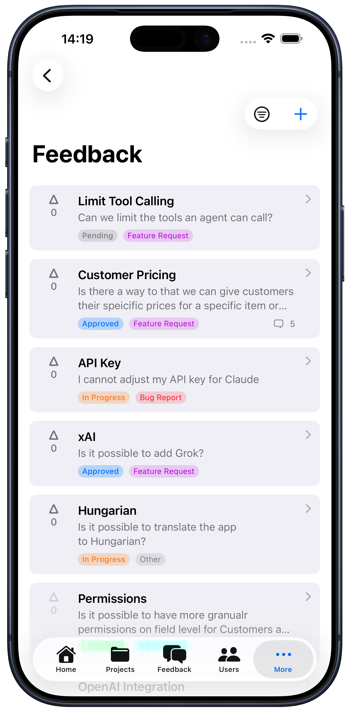
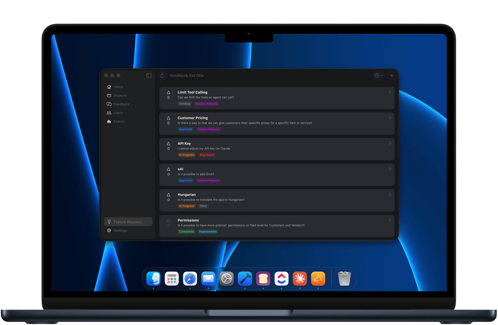
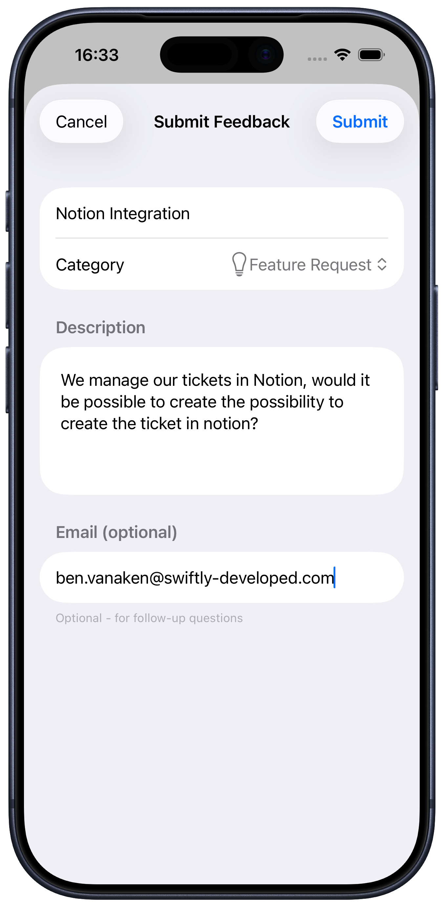
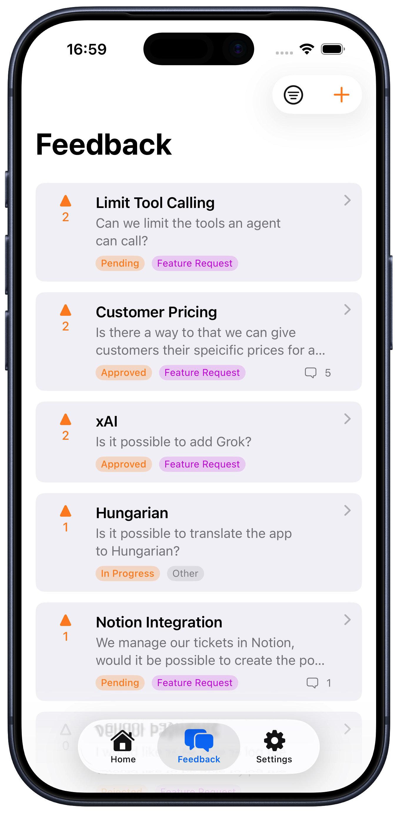
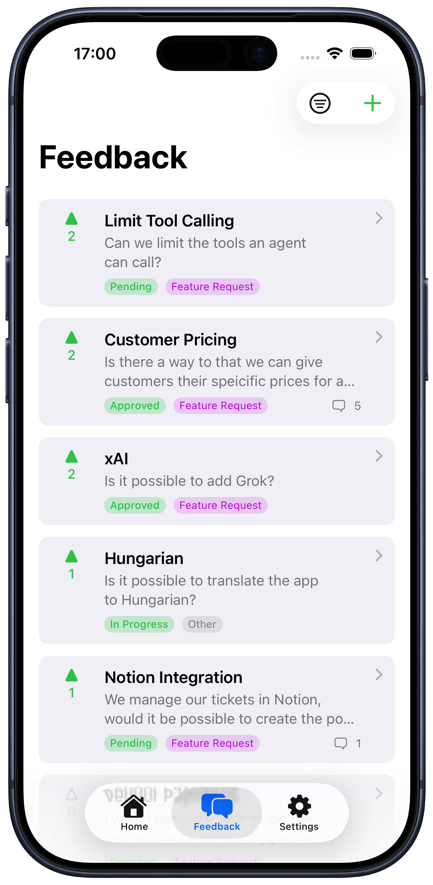
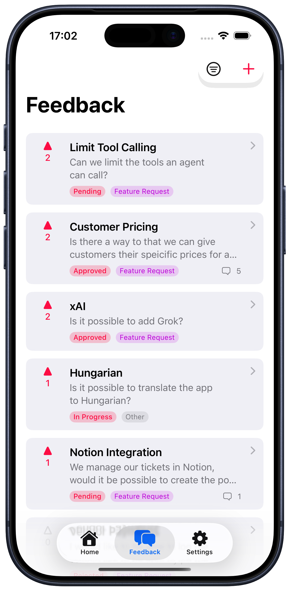
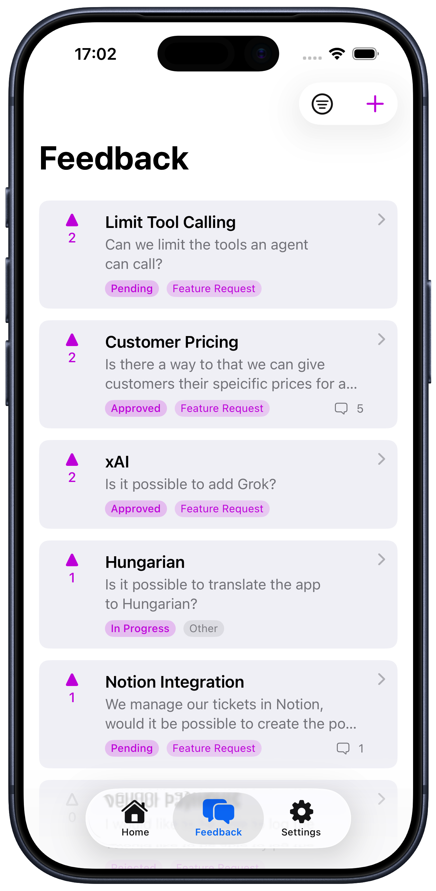
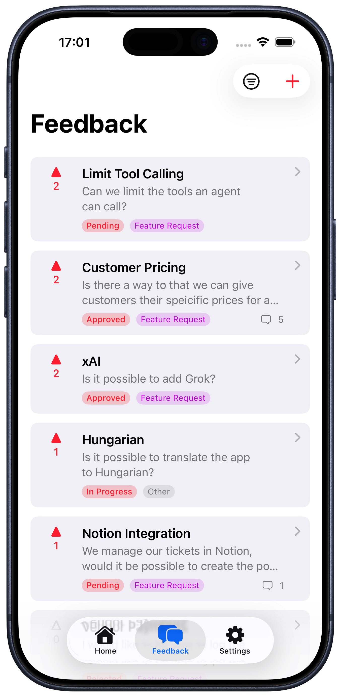
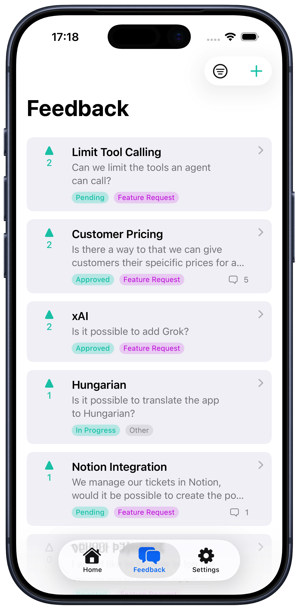
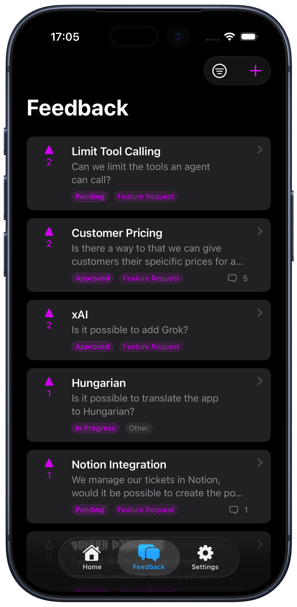

#  FeedbackKit

In-app feedback collection for iOS, macOS, and visionOS.


FeedbackKit is a Swift SDK that lets you collect, manage, and respond to user feedback directly within your app. Users can submit feature requests, report bugs, vote on ideas, and see what's being worked on — all without leaving your app.

Upgrading to 2.0.0: see [MIGRATION.md](MIGRATION.md).

## Multi-Platform SDKs

FeedbackKit is available for multiple platforms:

| Platform | Package | Install |
|----------|---------|---------|
| **Swift** (iOS/macOS/visionOS) | This package | Swift Package Manager |
| **JavaScript** | [feedbackkit-js](https://www.npmjs.com/package/feedbackkit-js) | `npm install feedbackkit-js` |
| **React Native** | [feedbackkit-react-native](https://www.npmjs.com/package/feedbackkit-react-native) | `npm install feedbackkit-react-native` |
| **Flutter** | [feedbackkit_flutter](https://pub.dev/packages/feedbackkit_flutter) | `flutter pub add feedbackkit_flutter` |
| **Kotlin/Android** | [com.getfeedbackkit:feedbackkit](https://central.sonatype.com/artifact/com.getfeedbackkit/feedbackkit) | Maven Central |

## Features

- **Ready-to-use SwiftUI views** — Drop-in feedback list, submission form, and detail views
- **Voting system** — Let users upvote feedback to surface popular requests
- **Comments** — Two-way communication between you and your users
- **Status tracking** — Show users the progress of their feedback (pending → approved → in progress → completed)
- **Categories** — Organize feedback by type: feature requests, bug reports, improvements
- **Feedback merging** — Duplicate feedback items can be merged from the admin side
- **Rejection reasons** — Explain why feedback was rejected with a visible reason
- **Theming** — Customize the primary color and the status and category colors to match your app's design
- **Dark mode** — Full support for light and dark appearances
- **Multi-platform** — iOS, macOS, and visionOS. No watchOS or tvOS target
- **Event tracking** — Built-in analytics for user engagement
- **MRR tracking** — Associate feedback with customer revenue
- **Localization** — Full String Catalog support for translations
- **Accessibility** — Full VoiceOver support with descriptive labels, hints, and localized accessibility strings

## Requirements

`Package.swift` declares these platforms and the language mode. It does not declare watchOS or tvOS.

- iOS 26+
- macOS 26+
- visionOS 26+
- Swift 6.2+
- Xcode 26+
- Swift 6 language mode (`swiftLanguageModes: [.v6]`)

## Published package

The public Swift Package Manager repository is [SwiftlyFeedbackKit-Swift-SDK](https://github.com/Swiftly-Developed/SwiftlyFeedbackKit-Swift-SDK). `https://github.com/Swiftly-Developed/SwiftlyFeedbackKit` redirects to that repository. There is no second public Swift package.

Published tags are `1.0.0`, `1.1.0`, `1.1.1`, `2.0.0`, and `3.0.0`. There is no `1.0.1` tag and no `2.1.0` tag. `1.1.1` and `2.0.0` compile in Swift 5 language mode and store settings on `config`, `theme`, and `shared`.

These docs describe **3.0.0**. A dependency written as `from: "3.0.0"` resolves that tag. Differences from 1.1.1 and 2.0.0 are in [MIGRATION.md](MIGRATION.md).

## Installation

### Swift Package Manager

Add FeedbackKit to your project using Xcode:

1. Go to **File → Add Package Dependencies...**
2. Enter the repository URL:
   ```
   https://github.com/Swiftly-Developed/SwiftlyFeedbackKit-Swift-SDK
   ```
3. Select version **3.0.0** (Up to Next Major) and add the **SwiftlyFeedbackKit** product

Or add it to your `Package.swift`:

```swift
dependencies: [
    .package(url: "https://github.com/Swiftly-Developed/SwiftlyFeedbackKit-Swift-SDK.git", from: "3.0.0")
]
```

```swift
.product(name: "SwiftlyFeedbackKit", package: "SwiftlyFeedbackKit")
```

The package runs a `GenerateStringCatalogSymbols` build-tool plugin. Xcode asks you to trust it once. A non-interactive `xcodebuild` passes `-skipPackagePluginValidation`.

## Quick Start

Get up and running in 3 steps:

### 1. Import and Configure

```swift
import SwiftlyFeedbackKit

@main
struct MyApp: App {
    init() {
        #if DEBUG
        SwiftlyFeedback.configure(environment: .development, key: "your-dev-api-key")
        #elseif TESTFLIGHT
        SwiftlyFeedback.configure(environment: .testflight, key: "your-staging-api-key")
        #else
        SwiftlyFeedback.configure(environment: .production, key: "your-prod-api-key")
        #endif
    }

    var body: some Scene {
        WindowGroup {
            ContentView()
        }
    }
}
```

> **Note:** To use the `TESTFLIGHT` flag, add it to your project's build settings under **Active Compilation Conditions** for your TestFlight build configuration.

### 2. Present the Feedback List

```swift
import SwiftlyFeedbackKit

struct ContentView: View {
    @State private var showFeedback = false

    var body: some View {
        Button("Send Feedback") {
            showFeedback = true
        }
        .sheet(isPresented: $showFeedback) {
            FeedbackListView()
        }
    }
}
```

### 3. That's it!

Your users can now browse existing feedback, submit new ideas, and vote on what matters most.



## Configuration

### Environments

| Environment | Server |
|-------------|--------|
| `.local` | `http://localhost:8080/api/v1` |
| `.development` | `https://api.dev.getfeedbackkit.com/api/v1` |
| `.testflight` | `https://api.testflight.getfeedbackkit.com/api/v1` |
| `.production` | `https://api.prod.getfeedbackkit.com/api/v1` |

### API Key Setup

Get your API key from the [FeedbackKit Admin app](https://www.getfeedbackkit.com):

1. Create or select a project
2. Go to **Project Settings → API Key**
3. Copy the key (starts with `sf_`)

### Configuration Methods

```swift
// Recommended: Explicit environment configuration
#if DEBUG
SwiftlyFeedback.configure(environment: .development, key: "your-dev-key")
#elseif TESTFLIGHT
SwiftlyFeedback.configure(environment: .testflight, key: "your-staging-key")
#else
SwiftlyFeedback.configure(environment: .production, key: "your-prod-key")
#endif

// Alternative: pick the key from the build type.
// DEBUG uses the development API, not localhost.
// Pass .local to configure(environment:key:) when you want localhost:8080.
SwiftlyFeedback.configureAuto(keys: EnvironmentAPIKeys(
    debug: "your-dev-key",        // Optional. Nil falls back to the testflight key.
    testflight: "your-staging-key",
    production: "your-prod-key"
))
```

> **Note:** `configureAuto(with:)` (single key) is deprecated. Use `configureAuto(keys:)` for multi-environment support. `updateUser(email:)` is a deprecated no-op. Set email on submit or in the vote dialog.

#### Setting Up the TESTFLIGHT Flag

To use the `#if TESTFLIGHT` compiler flag:

1. In Xcode, go to your target's **Build Settings**
2. Search for **Active Compilation Conditions**
3. Add `TESTFLIGHT` to your TestFlight/Staging build configuration

## Views

FeedbackKit provides three main SwiftUI views that handle all the UI and API interactions for you.

### FeedbackListView

Displays all feedback with sorting and filtering options.

```swift
// Basic usage
FeedbackListView()

// With custom instance
FeedbackListView(swiftlyFeedback: customInstance)
```

**Features:**
- Sort by votes (default), newest, oldest, or comment count
- Filter by status (pending, approved, in progress, etc.)
- Pull-to-refresh on iOS, refresh button (⌘R) on macOS
- Add feedback button (configurable)
- Empty state with call-to-action
- Request deduplication (prevents duplicate API calls)

**Sort Options:**

| Option | Description |
|--------|-------------|
| `.votes` | Highest vote count first (default) |
| `.newest` | Most recently created first |
| `.oldest` | Oldest first |
| `.comments` | Highest comment count first |

The list is searchable. Free text matches titles and descriptions. Suggested tokens filter by status and by category. The chosen sort is stored in `UserDefaults` and restored on the next launch.



### SubmitFeedbackView

A form for users to submit new feedback.

```swift
// Basic usage
SubmitFeedbackView()

// With dismiss callback
SubmitFeedbackView {
    // Called when the view is dismissed
    print("Feedback submitted or cancelled")
}
```

**Features:**
- Title and description fields
- Category picker (Feature Request, Bug Report, Improvement, Other)
- Optional email field
- Platform-optimized layouts (form on iOS, grid on macOS)
- Loading state during submission
- Keyboard shortcut on macOS (⌘Return to submit)

<table>
<tr>
<td></td>
<td></td>
</tr>
</table>

### FeedbackDetailView

Shows detailed information about a single feedback item.

```swift
FeedbackDetailView(feedback: selectedFeedback)
```

**Features:**
- Full title and description
- Status and category badges
- Vote button with count
- Comments section (admin comments styled differently)
- Rejection reason display (when status is rejected)
- Submission date

### Vote dialog

Voting with no preset email presents a dialog. The type is internal. You do not embed it. The list and the detail screen present the same dialog.

The dialog collects an optional email, a status-change notification toggle, and a mailing-list opt-in with operational and marketing sub-toggles. Skip votes without an email. Submit sends the address the user typed.

The dialog stays closed when `configuration.userEmail` is already set, and when `configuration.showVoteEmailField` is `false`.

### InvalidApiKeyView

Automatically shown when an invalid API key is detected. All interactive elements are hidden/disabled. No configuration needed. The screen includes Retry.

## Customization

Set `configuration` and `appearance` on the main actor: your `App` initializer, a SwiftUI view, or any `@MainActor` type. The 1.x names `config`, `theme`, and `shared` still compile and forward to these properties, with a deprecation warning. See [MIGRATION.md](MIGRATION.md).

### Feature Toggles

Control which UI elements are visible:

```swift
// Voting
SwiftlyFeedback.configuration.allowUndoVote = true          // Allow removing votes
SwiftlyFeedback.configuration.showVoteCount = true          // Show vote counts

// Badges
SwiftlyFeedback.configuration.showStatusBadge = true        // Show status badges
SwiftlyFeedback.configuration.showCategoryBadge = true      // Show category badges

// Form fields
SwiftlyFeedback.configuration.showEmailField = true         // Show email in submit form

// Comments
SwiftlyFeedback.configuration.showCommentSection = true     // Show comments in detail view

// List look: .showcase (default) or .classic (the 2.0 look)
SwiftlyFeedback.configuration.listStyle = .showcase

// Buttons
SwiftlyFeedback.configuration.buttons.addButton.display = true
SwiftlyFeedback.configuration.buttons.statusFilter.display = true    // Status in the Sort & Filter menu
SwiftlyFeedback.configuration.buttons.categoryFilter.display = true  // Category in the Sort & Filter menu

// Mailing list (submit form and vote dialog). Both default as written.
SwiftlyFeedback.configuration.showMailingListOptIn = true
SwiftlyFeedback.configuration.mailingListDefaultOptIn = false

// On-device translation of titles, descriptions, rejection reasons, and comments.
// Default true. The control is absent on visionOS and for unsupported language pairs.
SwiftlyFeedback.configuration.translationEnabled = true
```

### Disable Feedback Submission

Useful for paywalls or read-only modes:

```swift
SwiftlyFeedback.configuration.allowFeedbackSubmission = false
SwiftlyFeedback.configuration.feedbackSubmissionDisabledMessage = "Upgrade to Pro to submit feedback"
```

### Vote Notifications

Let users receive email notifications when feedback they voted on changes status:

```swift
// Pre-set user email (votes use this automatically, no dialog shown)
SwiftlyFeedback.configuration.userEmail = "user@example.com"

// Show email dialog when voting (only shown if userEmail is nil)
SwiftlyFeedback.configuration.showVoteEmailField = true  // default: true

// Default opt-in state for the "notify me" toggle
SwiftlyFeedback.configuration.voteNotificationDefaultOptIn = false  // default: false

// Sync email back to your app when user enters it via vote dialog
SwiftlyFeedback.configuration.onUserEmailChanged = { email in
    UserDefaults.standard.set(email ?? "", forKey: "userEmail")
}
```

**Behavior:**
- If `userEmail` is set: Votes automatically use that email, no dialog shown
- If `userEmail` is nil and `showVoteEmailField` is true: Users see a dialog to optionally enter email
- If `userEmail` is nil and `showVoteEmailField` is false: Votes submitted without email

Users who opt-in receive emails when feedback status changes (approved, in progress, completed, etc.) with a one-click unsubscribe link.

### Theming

Customize colors to match your app:

```swift
// Primary color (buttons, highlights)
SwiftlyFeedback.appearance.primaryColor = .color(.blue)

// Adaptive colors for dark mode
SwiftlyFeedback.appearance.primaryColor = .adaptive(
    light: .blue,
    dark: .cyan
)

// Use system accent color
SwiftlyFeedback.appearance.primaryColor = .default
```

#### Status Colors

Customize the color for each feedback status:

```swift
SwiftlyFeedback.appearance.statusColors.pending = .color(.gray)
SwiftlyFeedback.appearance.statusColors.approved = .color(.blue)
SwiftlyFeedback.appearance.statusColors.inProgress = .color(.orange)
SwiftlyFeedback.appearance.statusColors.testflight = .color(.cyan)
SwiftlyFeedback.appearance.statusColors.completed = .color(.green)
SwiftlyFeedback.appearance.statusColors.rejected = .color(.red)
```

#### Category Colors

Customize the color for each feedback category:

```swift
SwiftlyFeedback.appearance.categoryColors.featureRequest = .color(.purple)
SwiftlyFeedback.appearance.categoryColors.bugReport = .color(.red)
SwiftlyFeedback.appearance.categoryColors.improvement = .color(.teal)
SwiftlyFeedback.appearance.categoryColors.other = .color(.gray)
```

#### Theme Examples

<table>
<tr>
<td></td>
<td></td>
<td></td>
</tr>
<tr>
<td></td>
<td></td>
<td></td>
</tr>
</table>

### Dark Mode

FeedbackKit automatically adapts to the system appearance. Use adaptive colors for custom theming:

```swift
SwiftlyFeedback.appearance.primaryColor = .adaptive(
    light: .blue,
    dark: .cyan
)
```

<table>
<tr>
<td></td>
<td></td>
</tr>
</table>

## Direct API Access

For custom implementations, access the API directly. `current` is main-actor isolated and stays `nil` until `configure` finishes resolving a user id:

### Fetching Feedback

```swift
// Get all feedback
let allFeedback = try await SwiftlyFeedback.current?.getFeedback()

// Filter by status
let pending = try await SwiftlyFeedback.current?.getFeedback(status: .pending)

// Filter by category
let bugs = try await SwiftlyFeedback.current?.getFeedback(category: .bugReport)

// Combine filters
let pendingBugs = try await SwiftlyFeedback.current?.getFeedback(
    status: .pending,
    category: .bugReport
)

// Get single feedback by ID
let feedback = try await SwiftlyFeedback.current?.getFeedback(id: feedbackId)
```

### Submitting Feedback

```swift
let feedback = try await SwiftlyFeedback.current?.submitFeedback(
    title: "Dark mode support",
    description: "It would be great to have a dark mode option...",
    category: .featureRequest,
    email: "user@example.com"  // Optional
)
```

### Voting

```swift
// Vote for feedback
if let result = try await SwiftlyFeedback.current?.vote(for: feedbackId) {
    print("New vote count: \(result.voteCount)")
}

// Vote with email for status notifications
let result = try await SwiftlyFeedback.current?.vote(
    for: feedbackId,
    email: "user@example.com",
    notifyStatusChange: true
)

// Remove vote (if allowUndoVote is enabled)
let result = try await SwiftlyFeedback.current?.unvote(for: feedbackId)
```

### Comments

```swift
// Get comments for feedback
let comments = try await SwiftlyFeedback.current?.getComments(for: feedbackId)

// Add a comment
let comment = try await SwiftlyFeedback.current?.addComment(
    to: feedbackId,
    content: "Thanks for the suggestion!"
)
```

## Models

### Feedback

```swift
public struct Feedback: Identifiable, Codable, Sendable, Equatable {
    public let id: UUID
    public let title: String
    public let description: String
    public let status: FeedbackStatus
    public let category: FeedbackCategory
    public let userId: String
    public let userEmail: String?
    public let voteCount: Int
    public let hasVoted: Bool
    public let commentCount: Int
    public let rejectionReason: String?
    public let isHiddenOverLimit: Bool?
    public let mergedIntoId: UUID?
    public let mergedAt: Date?
    public let mergedFeedbackIds: [UUID]?
    public let createdAt: Date?
    public let updatedAt: Date?

    public var isMerged: Bool { mergedIntoId != nil }
}
```

### FeedbackStatus

| Status | Display Name | Can Vote | Icon |
|--------|-------------|----------|------|
| `pending` | Pending | Yes | — |
| `approved` | Approved | Yes | — |
| `inProgress` | In Progress | Yes | — |
| `testflight` | TestFlight | Yes | — |
| `completed` | Completed | No | — |
| `rejected` | Rejected | No | — |

### FeedbackCategory

| Category | Icon | Use Case |
|----------|------|----------|
| `featureRequest` | `lightbulb` | New functionality ideas |
| `bugReport` | `ladybug` | Issues and problems |
| `improvement` | `arrow.up.circle` | Enhancements to existing features |
| `other` | `ellipsis.circle` | General feedback |

### Comment

```swift
public struct Comment: Identifiable, Codable, Sendable, Equatable {
    public let id: UUID
    public let content: String
    public let userId: String
    public let isAdmin: Bool        // Admin comments have special styling
    public let createdAt: Date?
}
```

### VoteResult

```swift
public struct VoteResult: Codable, Sendable {
    public let feedbackId: UUID
    public let voteCount: Int
    public let hasVoted: Bool
}
```

## User Identification

FeedbackKit automatically manages user identity with the following priority:

1. **Custom user ID** — If set via `updateUser(customID:)`
2. **Existing stored ID** — Previously generated/set ID from Keychain
3. **iCloud user record ID** — If CloudKit is available
4. **Local UUID** — Generated and stored in Keychain (survives app reinstalls)

A custom id set while `configure` is still resolving is applied when the client is published. An iCloud lookup gives up after 3 seconds so an offline CloudKit call cannot leave `current` nil. Stored ids use an `icloud_` prefix for an iCloud record name and a `local_` prefix for a generated UUID.

### Custom User ID

```swift
// Set a custom user ID (e.g., after login). Updates the live client.
SwiftlyFeedback.updateUser(customID: "user_12345")
```

### Clearing User ID

```swift
// Clear the stored user ID from Keychain
UserIdentifier.clearUserId()
```

### MRR Tracking

Track Monthly Recurring Revenue to prioritize feedback from paying customers:

```swift
// Set user's subscription value
SwiftlyFeedback.updateUser(payment: .monthly(9.99))
SwiftlyFeedback.updateUser(payment: .yearly(99.99))
SwiftlyFeedback.updateUser(payment: .weekly(2.31))
SwiftlyFeedback.updateUser(payment: .quarterly(29.97))

// Clear on subscription cancellation
SwiftlyFeedback.clearUserPayment()
```

MRR data appears in the Admin app, allowing you to sort and filter feedback by customer value.

## Event Tracking

FeedbackKit includes built-in analytics to track user engagement.

### Automatic Tracking

By default, view events are tracked automatically when users open SDK screens:

- `feedback_list` — When FeedbackListView appears
- `feedback_detail` — When FeedbackDetailView appears
- `submit_feedback` — When SubmitFeedbackView appears

Disable automatic tracking:

```swift
SwiftlyFeedback.configuration.enableAutomaticViewTracking = false
```

### Custom Events

Track custom events in your app:

```swift
// Simple event
SwiftlyFeedback.view("onboarding_completed")

// Event with properties
SwiftlyFeedback.view("purchase_completed", properties: [
    "product_id": "pro_monthly",
    "price": "9.99"
])

// Predefined SDK views
SwiftlyFeedback.view(.feedbackList)
SwiftlyFeedback.view(.feedbackDetail)
SwiftlyFeedback.view(.submitFeedback)
```

## Metrics

Four read-only operations report aggregate usage for the project your API key identifies.
They are data, not UI — FeedbackKit ships no chart or dashboard view; you render what you
read.

```swift
let sf = SwiftlyFeedback.current!

// Totals over a trailing window
let summary = try await sf.metricsSummary(
    measures: [.feedbackCount, .voteCount, .eventCount],
    days: 30
)
let feedback = summary[.feedbackCount] ?? 0

// One row per day
let series = try await sf.metricsTimeseries(
    measures: [.eventCount],
    granularity: .day,
    days: 14
)

// Grouped by status, category or event name
let byStatus = try await sf.metricsBreakdown(
    measures: [.feedbackCount],
    dimension: .status,
    days: 30
)

// The raw event feed, one page at a time
let page = try await sf.metricsEvents(days: 7, page: 1, perPage: 50)
```

### Four things worth knowing before you ship a metrics screen

**1 · Empty buckets are present, not omitted.** A timeseries returns a zero-valued row for
every bucket in the window, so `series.isEmpty` never means "no activity" — it means the
window was empty of *buckets*. Branch on the values, not on the array:

```swift
let total = series.series.compactMap { $0[.eventCount] }.reduce(0, +)
if total == 0 { /* the genuinely-quiet case */ }
```

**2 · A Free-tier answer is a `200`, not an error.** Below Pro, a customer's own event names
are ingested and retained but not readable, so the server answers the narrower question and
says so. Read it off `meta`, do not infer it:

```swift
if summary.meta.eventScope == .predefinedOnly {
    // Only feedback_list / feedback_detail / submit_feedback were counted.
    // Custom events are still being recorded and become visible on upgrade,
    // with no re-tracking and no data loss.
}
if summary.meta.retentionClamped {
    // The requested window was wider than the plan allows and was narrowed.
}
```

The one request that *does* fail is the one with no honest narrower answer: breaking down by
`.eventName`, filtering by a custom `event_name`, or reading the raw event feed. Those raise
``SwiftlyFeedbackError/tierUpgradeRequired(code:message:)``.

**3 · Never hardcode 30, 90, or 365.** The plan's allowance is on every response, and it changes
when the customer's plan does:

```swift
let allowance = summary.meta.retentionWindowDays   // not a constant in your app
```

**4 · Pass an explicit `dateTo` when paging a live feed.** Without one, each page is
resolved against "now", events arriving between pages shift the offsets, and rows are
silently counted twice. Pin the window, page it, then advance the pin:

```swift
var cursor = lastSyncedAt
let windowEnd = Date()
var page = 1
while true {
    let batch = try await sf.metricsEvents(
        dateFrom: cursor, dateTo: windowEnd, page: page, perPage: 200
    )
    ingest(batch.items)
    if page >= batch.meta.totalPages { break }
    page += 1
}
cursor = windowEnd
```

### Measures and the tier ladder

| Measure | Readable with an API key |
|---|:--:|
| `feedbackCount`, `voteCount`, `commentCount`, `eventCount`, `uniqueEventUsers` | Yes |
| `sdkUserCount`, `mrrSum`, `mrrAverage`, `usersWithMrr` | No — use the authenticated project endpoint |

Requesting one of the second group raises
``SwiftlyFeedbackError/measureNotAvailable(measure:message:)``, naming the measure the server
refused. `MetricMeasure.isAvailableOnAPIKey` describes the split for your own UI; the SDK
does not act on it, because the server owns the allow-list and a client copy of it would
drift.

| Plan | Custom events readable | Metrics window |
|---|---|---|
| Free | No — predefined events only | 30 days |
| Pro | Yes | 90 days |
| Team | Yes | 365 days |

Tracking works on **every** plan, Free included. Events a Free project records are stored and
become readable the moment it upgrades — nothing needs re-tracking.

Values are keyed by the server's own measure tokens and are **sparse**: a breakdown's
overflow row (`isOverflow == true`) omits `uniqueEventUsers` entirely, because a distinct-user
count is not additive across the names it stands in for. Every typed accessor therefore
returns `Double?`, and force-unwrapping one will crash on a row you will meet in production.

## Localization

FeedbackKit uses String Catalogs for localization. All user-facing strings can be customized or translated.

To override SDK strings in your app:

1. Create a `Localizable.xcstrings` file in your project
2. Add the SDK's string keys with your custom translations
3. The SDK will use your translations automatically

## Error Handling

FeedbackKit provides typed errors for handling failures:

```swift
do {
    let feedback = try await SwiftlyFeedback.current?.submitFeedback(
        title: "My idea",
        description: "Details...",
        category: .featureRequest
    )
} catch let error as SwiftlyFeedbackError {
    switch error {
    case .invalidApiKey:
        print("Check your API key")
    case .feedbackLimitReached(let message):
        print("Limit reached: \(message ?? "Upgrade your plan")")
    case .networkError(let underlying):
        print("Network issue: \(underlying)")
    case .unauthorized:
        print("Authentication failed")
    case .notFound:
        print("Feedback not found")
    case .badRequest(let message):
        print("Bad request: \(message ?? "")")
    case .conflict:
        print("Conflict (e.g., duplicate vote)")
    case .serverError(let statusCode):
        print("Server error: \(statusCode)")
    case .decodingError(let underlying):
        print("Failed to decode response: \(underlying)")
    case .forbidden(let message):
        print("Not permitted: \(message ?? "")")
    case .rateLimited(let message):
        print("Slow down: \(message ?? "too many requests")")
    case .tierUpgradeRequired(let code, let message):
        print("Needs a paid plan (\(code?.rawValue ?? "")): \(message ?? "")")
    case .measureNotAvailable(let measure, _):
        print("\(measure ?? "That measure") needs the authenticated endpoint")
    case .invalidResponse:
        print("Error: \(error.localizedDescription)")
    }
} catch {
    print("Error: \(error.localizedDescription)")
}
```

`forbidden`, `rateLimited`, `tierUpgradeRequired` and `measureNotAvailable` are new in 2.0.0.
Before them a 403 and a 429 both arrived as `serverError(statusCode:)`, so a host app could
not tell "you may not do that" from "the server broke" and had no back-off signal at all.

### Invalid API Key

When an invalid API key is detected, the SDK automatically shows an error state in views with all interactive elements disabled.

### Feedback Limit Reached

`feedbackLimitReached` is the SDK's mapping for an HTTP 402 that is not the metrics custom-events refusal. The Free plan's 10-item feedback cap does not take that path. The submit succeeds, the row is stored with `isHiddenOverLimit == true`, and list reads omit it. The creator can still open their own hidden item. See [Plan limits](#plan-limits).

## Logging

FeedbackKit logs the HTTP method, path, and status code using OSLog. It does not log the API key, request or response bodies, email addresses, or user ids.

```swift
// Disable logging in production
SwiftlyFeedback.configuration.loggingEnabled = false
```

Logs appear in Console.app under the subsystem `com.swiftlyfeedback.sdk` with category `SDK`.

## Plan limits

The SDK does not enforce these numbers. The server does. A wider metrics window is clamped and returned as HTTP 200 with `meta.retentionClamped`. The feedback cap hides the extra row instead of refusing the write.

| Plan | Projects | Feedback per project | Members | Integrations | Custom events readable | Metrics window |
|------|----------|----------------------|---------|--------------|------------------------|----------------|
| Free | 1 | 10 visible | No | No | No. Predefined events only | 30 days |
| Pro | 2 | Unlimited | No | Yes | Yes | 90 days |
| Team | Unlimited | Unlimited | Yes | Yes | Yes | 365 days |

Project, member, and integration caps answer HTTP 402 on the admin API. They are not `X-API-Key` routes. On the SDK, a metrics request that can only be answered with custom events (`dimension: .eventName`, a custom `eventName` filter, or `metricsEvents`) raises `tierUpgradeRequired`. A Bearer-only measure raises `measureNotAvailable`.

Read the window you were given from `meta.retentionWindowDays`. Do not hardcode 30, 90, or 365.

## Platform support

| Platform | Minimum | In `Package.swift` |
|----------|---------|--------------------|
| iOS | 26 | Yes |
| macOS | 26 | Yes |
| visionOS | 26 | Yes |
| watchOS | — | No |
| tvOS | — | No |

### iOS
- Form-based submit view with sections
- Pull-to-refresh in feedback list
- Sheet presentation recommended
- On iPhone and iPad the list is a `NavigationSplitView`. Compact width shows the list. Regular width shows the detail beside it.

### macOS
- Grid-based submit view
- Minimum window size enforced (400×350 for submit, 380×300 for the vote dialog)
- ⌘Return shortcut to submit
- ⌘R shortcut to refresh the list, and to refresh comments on the detail screen
- The list is its own `NavigationStack`

### visionOS
- The same list, submit, detail, and vote dialog compile and run
- On-device translation is absent. There is no disabled control in its place

## Accessibility

FeedbackKit is built with accessibility in mind. All views are fully compatible with VoiceOver and assistive technologies.

### VoiceOver Support

Every interactive element includes descriptive labels, values, and hints:

- **Feedback list items** — Announces title, description, status, category, vote count, and comment count
- **Vote buttons** — Announces vote count, voted/not voted state, and context-aware hints (e.g., "Vote on this feedback", "Remove your vote", "Voting is closed")
- **Status & category badges** — Announces "Status: In Progress" or "Category: Bug Report"
- **Form fields** — Indicates required vs. optional fields with hints
- **Submit button** — Dynamic hint changes based on form validity ("Submit feedback" vs. "Complete all required fields to submit")
- **Comments** — Grouped elements for natural reading order
- **Loading states** — All progress indicators have descriptive labels
- **Decorative elements** — Hidden from VoiceOver (e.g., chevron icons)

### Localized Accessibility Strings

Accessibility strings live in the SDK's String Catalog and are localized with the rest of the catalog. No additional setup required. The public `Strings` enum from 1.x is gone. Override a string by adding its catalog key to your app's `Localizable.xcstrings`.

### Privacy Manifest

FeedbackKit includes a `PrivacyInfo.xcprivacy` privacy manifest that declares the data types collected by the SDK. When you run **Product → Archive** in Xcode and generate a privacy report from the Organizer, the SDK's data collection will appear automatically. The SDK declares:

| Data Type | Purpose | Linked to User |
|-----------|---------|:-:|
| User ID | App Functionality, Analytics | Yes |
| Email Address | App Functionality, Developer's Advertising or Marketing | Yes |
| Other User Content | App Functionality | Yes |
| Product Interaction | App Functionality, Analytics | Yes |
| Other Usage Data | Analytics | Yes |
| Purchase History | Analytics | Yes |

The SDK reads and writes `UserDefaults.standard` (the list sort and the translation target) and declares required-reason API `NSPrivacyAccessedAPICategoryUserDefaults` with reason `CA92.1`. It does not use file-timestamp, system-boot-time, disk-space, or active-keyboard APIs.

The SDK does not send a device identifier, device model, OS version, app version, or locale. Data is collected on your behalf; FeedbackKit is the processor. Questionnaire answers: [App Store privacy](../docs/privacy/APP-STORE-PRIVACY.md), [Google Play Data safety](../docs/privacy/GOOGLE-PLAY-DATA-SAFETY.md).

Which Accessibility Nutrition Labels the SDK screens support: [Accessibility Nutrition Labels](../docs/accessibility/ACCESSIBILITY-NUTRITION-LABELS.md).

## Example App

Check out the [SwiftlyFeedbackDemoApp](https://github.com/Swiftly-Developed/SwiftlyFeedbackDemoApp) for a complete integration example showing:

- Basic setup and configuration
- Presenting feedback views
- Custom theming
- Event tracking
- User identification

## Admin App

Manage your feedback from the [FeedbackKit Admin app](https://www.getfeedbackkit.com):

- Review and respond to feedback
- Update statuses
- Merge duplicate feedback
- View analytics and MRR data
- Configure integrations (Slack, GitHub, Linear, Notion, and more)
- Manage team members

## Support

- **Website:** [getfeedbackkit.com](https://www.getfeedbackkit.com)
- **Issues:** [GitHub Issues](https://github.com/Swiftly-Developed/SwiftlyFeedbackKit/issues)
- **Email:** info@swiftly-workspace.com

## License

FeedbackKit is available under the MIT license. See the [LICENSE](LICENSE) file for details.
